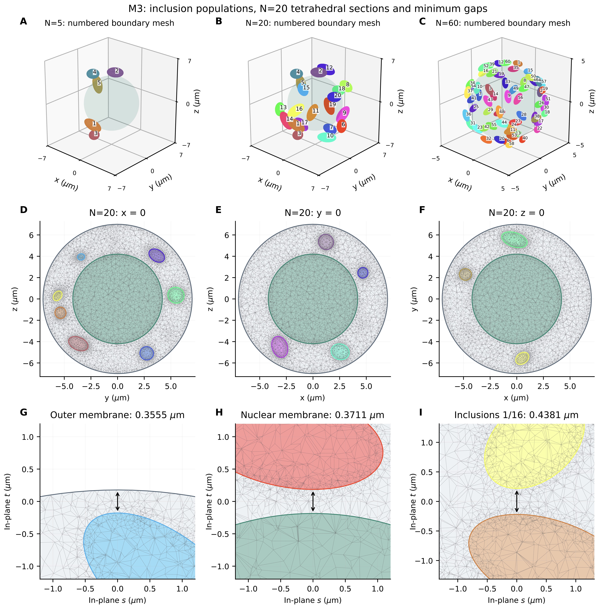

# Intracellular-Structure-dMRI-Cell-Size-Estimation

Cells in gray matter and tumors contain nuclei and membrane-bounded organelles,
yet diffusion MRI models for estimating cell size often assume that intracellular
water diffuses within a homogeneous sphere without internal barriers. We
investigated how neglecting these structures affects estimates of the outer cell
radius.

This repository accompanies the article 📢: 
> **Inside the Sphere: The Role of Intracellular Structure in Diffusion MRI Cell-Size Estimation.**
> Erick J. Canales-Rodríguez, Ekin Taskin, Juan Manuel Górriz, Jean-Philippe Thiran, Jonathan Rafael-Patiño

It provides numerical signal models from a homogeneous sphere (M0) to a concentric nucleus (M1), an eccentric
nucleus (M2), and intracellular inclusions (M3), together with the definitive data
and scripts used to assess cell-radius estimation.



*Example M3 geometries with 5, 20 and 60 inclusions. The lower panels show actual
tetrahedral sections and minimum-gap details for the 20-inclusion geometry.*

Functions are collected in a few modules; each experiment has a run script and
a plot script with editable settings. No package installation is needed.

```text
signals.py           M0 real expm, M0-Strang/Numba, M0-GPA, concentric M1
fitting.py           original profiled-S0 WLS, multistart fitting, noise, metrics
signals_fem.py       optional original MATLAB/SpinDoctor calculation
plot_style.py        shared colors, method names, fonts
run_all.py           sequential execution of the four run scripts
example_signals.py   standalone signal-generation and plotting guide
verify.py            small numerical and same-data fitting checks
M0/ ... M3/
    run_M*.py        load results / refit observations / regenerate signals
    plot_M*.py       numerical plots and, for M2/M3, actual mesh rendering
    data/            frozen experiment.npz and individual-fit CSVs
    results/         new summaries or explicit refits; created automatically
figures/             eight regenerated vector PDFs
fem/                 original MATLAB drivers in one file; external licenses
```

## Run

Verified with Python **3.12.12** and the versions in `requirements.txt`:

```bash
python3.12 -m venv .venv
source .venv/bin/activate
python -m pip install -r requirements.txt
python run_all.py
```

Or run `python M0/run_M0.py`, `python M1/run_M1.py`, `python M2/run_M2.py`,
`python M3/run_M3.py` independently. Default `MODE='saved'` loads accepted
estimates, calculates summary CSVs and draws figures. It runs no fits or FEM.
`python M2/plot_M2.py`, for example, only draws the two M2-related figures.

For a standalone forward-model example, run `python example_signals.py`. It
calculates M0/M1 at R=7 um, D=2 um²/ms and P1, and loads matching M2/M3 FEM cases.
The editable settings and actual forward calls are in that single script. Its
PDF, CSV and NPZ go to `example_output/`. Set `FEM_MODE='compute'` to regenerate
the chosen FEM cases with MATLAB/SpinDoctor, or `INCLUDE_FEM=False` to explore
arbitrary M0/M1 parameters. Different FEM acquisitions require regeneration;
saved signals are never interpolated. These example outputs do not enter the
manuscript analyses.

Edit `MODE` near the top of a run script:

- `'saved'`: reproduce from frozen numerical results in `data/`.
- `'refit'`: fit the **same saved observations**, write new CSVs in `results/`
  and plot them. This is a full experiment; it can take hours. Edit
  `N_WORKERS` (default8) and keep one BLAS thread per worker.
- `'regenerate'`: recompute only `REGENERATE_CASES` (default one case), save
  separate signals in `results/`, and stop. Physical parameters come from
  `data['conditions']`; new signals are never silently promoted to manuscript
  inputs. M2/M3 require the external software described below.

`run_all.py` respects each script's current MODE. Standalone plot scripts use
`results/fits*.csv` if present, otherwise `data/fits*.csv`; pass a DataFrame to
`plot_results(frame)` for an explicit source. `MODE='saved'` always uses `data/`.

## Models, units and fits

| Model | Signal generation | Saved cases / fits |
|---|---|---|
| M0 | Homogeneous reflecting sphere, real spectral expm | 28 / 10,268 |
| M1 | Concentric permeable aqueous nucleus, real spectral expm | 28 / 3,570 |
| M2 | Eccentric nucleus, SpinDoctor FEM | 18 / 2,295 |
| M3 | Aqueous ellipsoidal inclusions, SpinDoctor FEM | 18 / 2,346 |

This folder contains the definitive cases underlying the eight selected figures.

Units: R/a in **um**, D in **um²/ms**, delta/Delta in **ms**, b in **s/mm²**,
G in **T/m**. Public `m1_signal` takes physical kappa in **um/s**; the internal
Bessel kernel uses um/ms. Dimensionless h=kappa*R/Dc is recomputed each call.

```python
from signals import published_protocol, m0_signal, m0_strang_signal, gpa_m0_signal, m1_signal
p = published_protocol('P1')['protocol']  # also supplies counts and source metadata
s = m0_signal(7., 2., p)                 # real expm, default150 spatial modes
s = m0_strang_signal(7., 2., p)          # same model,150 modes,64 steps PER pulse
s = gpa_m0_signal(7., 2., p, terms=128)  # separate Gaussian-phase approximation
s = m1_signal(7., 4.2, 2., 2., 200., p) # default600 modes; kappa=0 or inf allowed
```

`pgse_protocol(b,delta,Delta)` also accepts custom arrays and derives G using
the finite-pulse b formula.

Fitting uses the original scaled-physical-coordinate multistart L-BFGS-B,
D-stratum starts for joint fits, residual refinement and uniform retry policy.
Bounds: R=[2,20], D=[0.3,3]. S0 is eliminated at **every** evaluation:
`S0 = sum(counts*means*f) / sum(counts*f*f)`, including the noisy baseline group.
Its b=0 mean only ranks starts; there are no amplitude bounds. P1 has 5 shells
and 5 independent b=0 observations; P2 has 8 and 8, plus 256 DW observations each.
M0 has fixed-D Strang/GPA and free-D Strang experiments. For M1-M3, P1 uses
free-D Strang plus fixed-D Strang/GPA; P2 uses free-D Strang/GPA. All outliers,
boundary solutions and optimizer failures remain in the data and plots.

## Data and figures

Load an experiment with `fitting.load_experiment('M2/data/experiment.npz')`.
Arrays: `signals[case,shell]`, `dwi[case,snr,rep,measurement]`, `b0`, `means`,
`counts`, `S0_initial`, `noiseless`, `snrs`; physical dictionaries are in
`conditions`, matching `case_ids` order. There are50 repetitions; M0 SNRs are
20/50/100, other models50. P1 uses only the first5 shells,6 mean entries and
5 baselines; remaining padding is NaN (counts0). CSV `snr=0` means **noiseless**.
`direct150` and `gpa128` are populated for M0. `fem_jobs` retains the original
geometry, operator and spherical-quadrature choices for every M2/M3 case.

| Script | Exact generated manuscript filenames |
|---|---|
| `M0/plot_M0.py` | Fig04_M0_FixedDiffusivity, Fig05_M0_JointRadiusDiffusivity |
| `M1/plot_M1.py` | Fig06_M1_NuclearPermeability |
| `M2/plot_M2.py` | Fig02_DisplacedNucleusMesh, Fig07_M2_NuclearDisplacement |
| `M3/plot_M3.py` | Fig03_OrganelleInclusionMesh, Fig08_M3_InclusionVolumeFraction, Fig09_M3_InclusionPermeability |

All outputs are **vector PDF**, drawn with Matplotlib from numerical arrays.
All subpanels use **A, B, C...**, uppercase bold without parentheses, through
`plot_style.panel_label`; the shared style hash is embedded in each PDF.
Mesh figures use actual boundary triangles and tetrahedron/plane intersections;
no figure crops, image inputs or raster panels are used. `meshes.npz` contains
full volume data for the two displayed eccentric geometries and N=20; N=5/60
retain the boundary triangles/nodes needed for their 3D panels. Layouts and
minimum-gap coordinates are included. The composition is recreated as real
subplots, rather than pixel-identical reproduction of manual Gimp edits.

## Optional physical FEM regeneration

Obtain [SpinDoctor](https://github.com/SpinDoctorMRI/SpinDoctor) separately:

```bash
git clone https://github.com/SpinDoctorMRI/SpinDoctor.git /path/to/SpinDoctor
git -C /path/to/SpinDoctor checkout 7b97c43a42b6dbb6d51a93ddfc1e66596a85c066
export SPINDOCTOR_ROOT=/path/to/SpinDoctor
```

MATLAB must be on PATH (or set `MATLAB` in the script). The mesh drivers use
SpinDoctor's `src/tetgen/lin64/tetgen`; other OS paths require adaptation.
Inspect `fem_jobs` before executing one case at a time: large cases can require
tens of GiB and hours. Internal FEM units are um/us. Sealed compartments retain
all stationary modes and the original local/component completion; finite
permeability uses the coupled problem. Transparent inclusions recover M1 with
its nuclear barrier.

## Checks and provenance

`python verify.py` checks original noise streams for all 92 cases, saved M0/M1
signal agreement, GPA and Numba consistency, zero modes, M1 limits, units,
profiled S0, and four representative same-data fits.

Original code: **MIT** (`LICENSE`). SpinDoctor GPL and TetGen AGPL notices are
kept in `fem/LICENSES.txt`; those programs are not redistributed here. Cite the
associated manuscript and external numerical software when reusing them.
